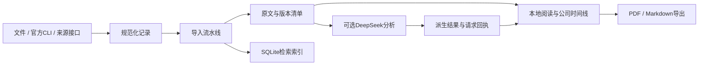

# 架构与数据流

FastAPI + Jinja2 服务端渲染，SQLite 运行视图，Markdown 原文与 manifest 作为归档依据。无需前端构建。

## 核心文件

- `app/config.py`：配置与回环地址校验。
- `app/storage.py`：目录布局、原子写入和 manifest。
- `app/pipeline.py`：校验、重复识别、修订归档、恢复及索引重建。
- `app/index.py`：SQLite 查询与文档索引。
- `app/sources.py`、`app/youdao.py`：知识星球 CLI、公开分享提取及原图缓存。
- `app/securities.py`、`app/hk_securities.py`：证券名称代码目录。
- `app/financials.py`：财务数据与来源缓存。
- `app/research.py`、`app/llm.py`：可选分析、定时器、模型回执和请求上限。
- `app/token_economy.py`：去除输入噪声与分析指纹。
- `app/publication.py`：阅读、公司、事件与简报视图。
- `app/evidence.py`、`app/company_research.py`：人工证据与研究笔记。
- `app/document_pdf.py`：固定修订的本地 PDF 导出。
- `app/web/`：路由、模板和静态样式。

## 更新语义

同来源主键用于识别同一条资料。正文变化追加修订，原文不被 AI 覆盖。资料页默认当前修订，历史链接固定修订；摘要只在对应修订有效。标题 / 链接变化且文字不变时可复用分类结果并重固定版本。深度结构化结论独立缓存，不把单次摘要当成独立双次审核。

## 运行假设

一份数据目录配一个服务进程。定时器和任务队列运行在本机进程内，不应多 worker 同时写同一资料目录。模型与下载均受网络和授权影响；本地定时器无法在电脑休眠时运行。备份整个数据目录，避免遗漏人工证据数据库和用户笔记。
