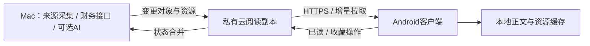

# 手机阅读原型与同步设计

状态：交互原型已提供，APK、云服务与实际资料同步尚未实现。原型全部使用合成数据，不包含账号、服务器地址或私人研究内容。

## 体验入口

启动 ResearchDock 后打开 `/mobile-preview`（如本机默认端口：http://127.0.0.1:8001/mobile-preview）。这是一份可交互网页原型，用来评审手机布局，并不是已经安装到安卓的 App。

| 已可体验 | 说明 |
| --- | --- |
| 研究动态 | 示例资料列表、关键词搜索、收藏与已读标识 |
| 行业 | 半导体、新能源、医药生物筛选 |
| 公司 | 示例公司、财务数字和按日期排列的调研时间线 |
| 原件 | PDF / 音频列表样式，原型只显示占位，不下载文件 |
| 阅读 | 原文要点、信息局限、资料版本 |
| 设置 | 深色阅读与离线状态演示；不代表真实离线缓存 |

收藏和已读只保存在当前页面内存，刷新即重置；不存在真实账号或服务器同步。原型的离线开关仅用于查看产品状态。

## 推荐方向：Mac 权威写入，云端阅读副本

这是待确认的架构建议。它允许 Mac 休眠时继续读最后同步的资料，但无法在 Mac 休眠时产生新采集内容。云端能看到同步后的明文资料；HTTPS 是传输保护，不等于端到端加密。是否需要 E2EE 应在云端检索与预览方案确定前讨论。

## 同步对象白名单（设计草案）

- Document：稳定 document_id、revision、正文哈希、标题、正文、来源展示信息、发布时间。摘要可空，未经过 AI 的原文也能同步。
- Classification：已生成的行业、公司引用与摘要；手机不触发新的模型任务。
- Company：稳定证券 ID、名称代码、已获取财务数据和来源 / 报告期。
- Asset：资源 ID、文档修订、内容哈希、类型、大小；图片和 PDF 通过鉴权接口下载，临时签名不作为永久资源标识。
- ReadingOperation：设备操作 ID、文档 ID、已读 / 收藏状态；与源正文的单向发布分开处理。

不进入阅读同步包：DeepSeek Key、CLI 授权、Cookie、模型回执、系统日志、Mac 绝对路径、导入任务内部文件。人工私人笔记是否同步应单独可选，不默认整库上传。

## 同步协议需要满足的条件

1. Mac 本地变更队列在云端确认后才推进水位，断网重试不重复创建资料。
2. 使用服务端序列 / 游标分页，不能只用不同机器的系统时间决定同步边界。
3. 文档修订不可变；同篇新修订更新“当前版本”，旧引用继续指向原修订。
4. 资料删除 / 撤回使用明确事件；一页数据缺少某条资料不应推断为删除。
5. 失效游标返回明确的重新同步指令；全量恢复期间保留旧阅读副本，成功后切换。
6. 正文、摘要、附件、分类可以分别更新；AI 后到不能阻断原文先到。
7. 手机设备可单独撤销；Mac 发布权限与手机阅读权限分离。
8. 手机修改已读 / 收藏可以离线排队，服务端分配顺序并幂等处理；不能把正文同步的权限顺带开放给手机。
9. 原图和 PDF 缓存有容量上限；手动保留与自动清理分开，下载成功后再替换旧副本。
10. 显示来源采集、云端接收与手机同步的时间，避免把旧副本显示成实时资料。

以上是设计要求，不是当前已有 API。实现阶段需要版本化 API、事务、鉴权、请求大小上限与接口测试。

## 首版 APK 范围建议

优先实现：授权设备、研究动态、行业筛选、公司时间线、原文与图片阅读、按需下载 PDF、阅读缓存和同步状态。后续再做跨设备收藏、关注提醒和推送。暂不添加手机端模型调用、源正文编辑、音频转写、OCR 或估值。

技术选型待确认：若仅支持 Android，原生 Kotlin 是候选；若近期需要 iOS，则比较 Flutter / React Native 的维护和第三方阅读组件。当前原型用于评审交互，不预先锁定技术栈。

## 验收场景

- 无 DeepSeek Key 的新资料可以同步和阅读。
- Mac 停机时仍可读已经到达云端 / 手机缓存的副本，并明确显示更新时间。
- 同一篇资料出现新修订时更新缓存；历史证据引用不漂移。
- 断网、重复请求、分页中断、游标失效可恢复。
- 图片、PDF 下载具备权限，撤销设备后不能继续取得新资料。
- 同步和手机阅读的模型请求数为零。
- 公开源码、APK 和 CI 日志不含个人主机地址或凭据。
